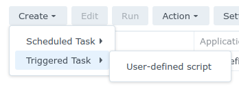
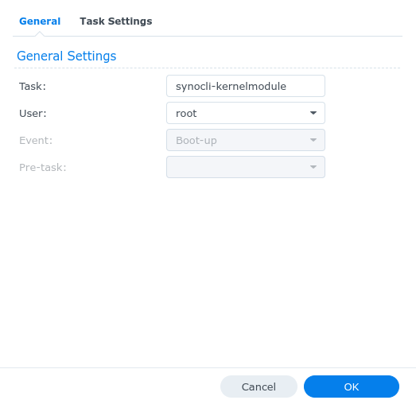
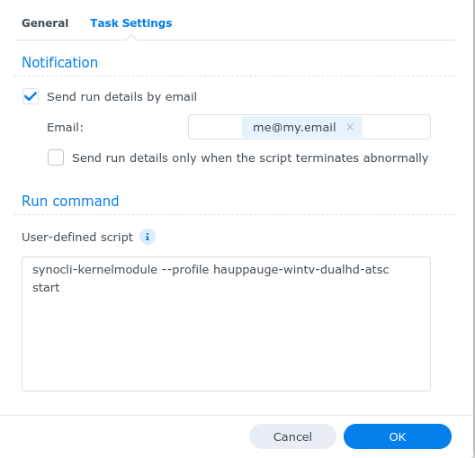

# SynoCli Kernel Tools

!!! warning "Experimental, at your own risk"
    The kernel modules of SynoCommunity packages are outside of what Synology
    supports: a module that does not suit the kernel can crash the NAS, and DSM
    updates may break them. Support is limited: read this documentation, and
    check the issues already open, before opening one. Do not use them on a NAS
    you cannot afford to restart or recover.

The `synocli-kernel` package provides USB and process helpers (`usb-devices`,
`lsusb.py`, `usbhid-dump`, `fuser`), the `synocli-kernelmodule` helper that loads
the kernel modules of the `synokernel-*` packages, and the device profiles it
loads them by. Every kernel module package depends on it.

## Package Information

| Property | Value |
|----------|-------|
| Package Name | synocli-kernel |
| License | GPL |

To add as a dependency in `spk/<package>/Makefile`, from the version that
holds the profiles:
```makefile
SPK_DEPENDS = "synocli-kernel>=2.0"
```

## Kernel Module Helper Script

`synocli-kernelmodule` loads the modules of a `synokernel-*` package, one device
at a time, through the profile of that device. Run as root:

```bash
# Profiles of every synokernel-* package, and whether the package is installed
# and this kernel has all their modules (available, or n/a with what is missing)
synocli-kernelmodule list

# The modules a profile loads, in order, and where each comes from
synocli-kernelmodule --profile hauppauge-wintv-dualhd-atsc modules

# What start would do, without loading anything (no root needed)
synocli-kernelmodule --profile hauppauge-wintv-dualhd-atsc --dry-run start

# Load, check and unload the modules of a device
sudo synocli-kernelmodule --profile hauppauge-wintv-dualhd-atsc start
sudo synocli-kernelmodule --profile hauppauge-wintv-dualhd-atsc status
sudo synocli-kernelmodule --profile hauppauge-wintv-dualhd-atsc stop

# Several profiles of one package
sudo synocli-kernelmodule --spk synokernel-usbserial --profile ch341,cp210x start

# Modules by name, without a profile
sudo synocli-kernelmodule --spk synokernel-cdrom sr_mod start
```

| Option | Use |
|--------|-----|
| `-p`, `--profile <p1,p2,...>` | profiles to load; the package is the one they are for |
| `-s`, `--spk <package>` | package holding the modules, needed for modules by name |
| `-n`, `--dry-run` | `start`, `stop` and `restart` tell each step (`OK (simulated)`, or `missing`) and change nothing |
| `-r`, `--root <dir>` | package directory other than `/var/packages/<package>/target`, to try modules before packaging them |
| `-v`, `--verbose` | modules in load order, and the comments of each profile |

Each module comes after the modules it depends on, read from the `depends=` of
the module itself: a profile lists the modules of its device, not the media or
USB cores they need. A module the package does not have is taken from the
kernel (`modprobe`, or `/lib/modules`).

`stop` unloads in reverse order and leaves loaded a module still in use, by
another device for instance. The firmware of the package (`target/lib/firmware`)
is given to the kernel firmware loader on `start`; the output of every run goes
to `/var/log/packages/synocli-kernelmodule.log`, starting with the warning above.

Modules are looked for in
`/var/packages/<package>/target/lib/modules/<platform>/<uname -r>/`, the
platform being the one `uname -a` names (`synology_<platform>_<model>`).

### Loading modules at boot

The `synokernel-*` packages are not services: DSM loads none of their modules,
at installation or at boot. To load those of a device at every startup, create
a task in DSM:

1. *Control Panel* > *Task Scheduler* > *Create* > *Triggered Task* >
   *User-defined script*

   

2. *General*: *Task* a name such as `synocli-kernelmodule`, *User* `root`,
   *Event* `Boot-up`, *Enabled* checked

   

3. *Task Settings*: optionally *Send run details by email*, with *Send run
   details only when the script terminates abnormally*, to hear of a device
   that failed to load
4. *Task Settings* > *Run command*: one line per package, as the profiles of
   one command must come from the same package:
   ```bash
   synocli-kernelmodule --profile hauppauge-wintv-dualhd-atsc start
   synocli-kernelmodule --profile cdrom start
   ```

   

5. *OK*, then select the task and *Run* it once to check it, or reboot

The output of each run is in `/var/log/packages/synocli-kernelmodule.log`.
After a DSM update that changes the kernel, install the build of the packages
for that DSM version: the task then loads the new modules.

### Device profiles

A profile is one JSON file per device. The profiles are part of this package,
not of the packages of kernel modules: a new device only needs a new release of
SynoCli Kernel Tools. They are in `spk/synocli-kernel/src/profiles/<package>/`,
installed in `target/etc/profiles/<package>/`, the directory naming the package
of the modules. The file name is the profile name:

```json
{
  "name": "hauppauge-wintv-dualhd-atsc",
  "description": "Hauppauge WinTV-dualHD 01595, ATSC and ClearQAM (USB 2040:026d)",
  "comments": "Two tuners, /dev/dvb/adapter0 and adapter1, and its remote control.",
  "modules": ["si2157", "lgdt3306a", "rc-hauppauge", "em28xx-dvb", "em28xx-rc"]
}
```

| Field | Content |
|-------|---------|
| `name` | the file name, without `.json` |
| `description` | one line, shown by `list`: device, and its USB id |
| `comments` | optional: quirks, what was tested and where |
| `modules` | modules of the device, in load order, without `.ko`; `-` and `_` are the same |
| `kernels` | optional: other module lists for some kernels (below) |
| `udev` | optional: rules files of `target/etc/rules.d` the device needs |

Where a kernel needs other modules, `kernels` gives lists by kernel version;
the first entry whose `min` and `max` bracket the running kernel replaces
`modules`, either bound being optional:

```json
  "modules": ["si2157", "si2168", "em28xx-dvb"],
  "kernels": [
    { "max": "3.9", "modules": ["si2157", "si2168", "em28xx-dvb", "i2c-mux"] }
  ]
```

### udev rules

A profile can name rules files (`udev`), from `src/rules.d/` of this package,
installed in `target/etc/rules.d/`: on `start` they are linked into
`/lib/udev/rules.d` and udev reloads them, on `stop` they are removed. The
profiles of `synokernel-usbserial` use one for every driver,
`60-synokernel-usbserial.rules`, which opens the serial devices to every user:

```
KERNEL=="ttyACM*", ACTION=="add", MODE="0666"
KERNEL=="ttyUSB*", ACTION=="add", MODE="0666"
```

Without it `/dev/ttyUSB*` and `/dev/ttyACM*` belong to root alone, and a service
running as its own user (Home Assistant, Zigbee2MQTT, ...) cannot open them. A rule
applies to the devices that appear once it is in place: plug the device after
`start`, or unplug and plug it again.

### Writing a profile

1. Find the driver of the device: its USB id (`usb-devices`) in the driver sources,
   `drivers/media/usb/*/*-cards.c` for most TV tuners, names the board and the
   bridge module (`em28xx`, `dvb-usb-*`).
2. The bridge module loads the tuner and demodulator chips of the board only
   when they are already loaded: list them first. The board entry names them
   (`si2157`, `lgdt3306a`), and `dmesg` reports one that is missing when the
   device is plugged in.
3. Add the bridge and its parts for the device (`em28xx-dvb` for DVB,
   `em28xx-rc` for the remote control, and the keymap module `rc-*` of the
   board).
4. Try it before packaging it: put the profile in
   `/var/packages/synocli-kernel/target/etc/profiles/<package>/` on the NAS,
   and run `sudo synocli-kernelmodule --profile <name> --verbose start`.
5. Check `dmesg` and `/dev/dvb`, then `stop`, which must leave no module of
   the profile loaded (`status`).
6. Put the file in `spk/synocli-kernel/src/profiles/<package>/`, with what was
   tested and on which NAS in `comments`.

## Building Kernel Module Packages

### Configuration

Kernel dependency usage is enabled with `REQUIRE_KERNEL = 1`.

Automated building of modules uses `REQUIRE_KERNEL_MODULE`:
```makefile
REQUIRE_KERNEL_MODULE  = CONFIG_USB_SERIAL:drivers/usb/serial:usbserial
REQUIRE_KERNEL_MODULE += CONFIG_USB_SERIAL_CH341:drivers/usb/serial:ch341
REQUIRE_KERNEL_MODULE += CONFIG_USB_SERIAL_CP210X:drivers/usb/serial:cp210x
```

Each configuration option consists of 3 sub-variables, and an optional fourth:

1. **Kernel configuration option** - `CONFIG_*` symbol
2. **Kernel directory tree** - Path where the module source is located
3. **Module name** - Without `.ko` extension
4. **Kernel feature it needs** (optional) - a `CONFIG_*` symbol the kernel must
   have built in (`=y`), read from the kernel's own config; on a kernel without
   it, the module is neither enabled nor built

A kernel that does not offer the option, or has no such directory, skips the
module: a driver that moved between kernels is listed once per directory, as
`drivers/net/wireless/rt2x00` became `drivers/net/wireless/ralink/rt2x00`. The
modules of a directory can use those of the directories built before it:
`depends=` names them, and `synocli-kernelmodule` loads them first.

A module that builds on a bool feature of the kernel cannot work where the kernel
lacks that feature: `regmap-i2c` needs the regmap core, which some kernels do not
have and which cannot be built as a module.

```makefile
REQUIRE_KERNEL_MODULE = CONFIG_REGMAP_I2C:drivers/base/regmap:regmap-i2c:CONFIG_REGMAP
```

Where the modules sit behind a menu the kernel is built without,
`REQUIRE_KERNEL_OPTION` sets options before them, `CONFIG_<option>=y|m|n`. An
`=n` names a built-in option the modules must not turn on, as it changes the
structures of the running kernel: it is left as the kernel has it, and the build
stops if `olddefconfig` turns it on all the same. The build log lists the
built-in options the modules turned on and off, to check that only menus did:

```makefile
# The wireless stack, without the wireless extensions that add fields to
# struct net_device
REQUIRE_KERNEL_OPTION  = CONFIG_WIRELESS=y CONFIG_WLAN=y
REQUIRE_KERNEL_OPTION += CONFIG_CFG80211_WEXT=n CONFIG_WIRELESS_EXT=n CONFIG_WEXT_CORE=n
```

### Module Installation Structure

When `REQUIRE_KERNEL_MODULE` is not empty, kernel modules are compiled and installed by `spksrc.kernel.mk`, one directory per platform and kernel, the kernel named as `uname -r` names it:

```
lib/modules
└── apollolake
    └── 4.4.302+
        └── drivers
            └── usb
                ├── class
                │   └── cdc-acm.ko
                └── serial
                    ├── ch341.ko
                    ├── cp210x.ko
                    └── ftdi_sio.ko
```

### Out-of-tree drivers

A driver that is not part of the kernel tree lives in `driver/<name>` and includes
`spksrc.driver.mk`. Listed in the spk `DEPENDS`, it is built right after each kernel the
spk prepares, against that kernel's source (`$(KERNEL_ROOT)`), and installs its modules
in `$(DRIVER_MODULE_DIR)` next to those of `REQUIRE_KERNEL_MODULE`:

```makefile
# driver/<name>/Makefile
DRIVER_KERNEL_MIN = 3.10    # skipped on older kernels
DRIVER_GCC_MIN    = 4.9     # and with an older gcc

include ../../mk/spksrc.driver.mk
```

The `driver/*` a driver lists in its `DEPENDS` are built first, for the same
kernel: `driver/linuxtv-*` take their media tree from `driver/linux-media-*`.

Where one version of a driver cannot serve every kernel, a driver without sources
(no `PKG_DIST_SITE`) is a selector: it builds the first of its `DEPENDS` that is
not skipped, kernel by kernel. `driver/linuxtv` does so for
[SynoKernel LinuxTV](synokernel-linuxtv.md):

```makefile
# driver/linuxtv/Makefile
DEPENDS  = driver/linuxtv-4.4
DEPENDS += driver/linuxtv-3.10
DEPENDS += driver/linuxtv-3.2

include ../../mk/spksrc.driver.mk
```

## Troubleshooting

### A module fails to load

`dmesg` names the cause. `Unknown symbol` means a module needed is not loaded:
one the device loads on demand (a tuner or demodulator) belongs in the profile.
`disagrees about version of symbol` or `invalid module format` means the
package does not match the running kernel, typically after a DSM update.

### No modules for this kernel

The package has no modules for the running kernel: it was built for another
DSM version. Install the build of the package for that DSM version.

## Related Packages

- [SynoKernel USB Serial](synokernel-usbserial.md) - USB serial drivers
- [SynoKernel LinuxTV](synokernel-linuxtv.md) - TV tuner drivers
- [SynoKernel WiFi](synokernel-wifi.md) - USB WiFi adapter drivers
- [SynoCli Misc Tools](synocli-misc.md) - System utilities
